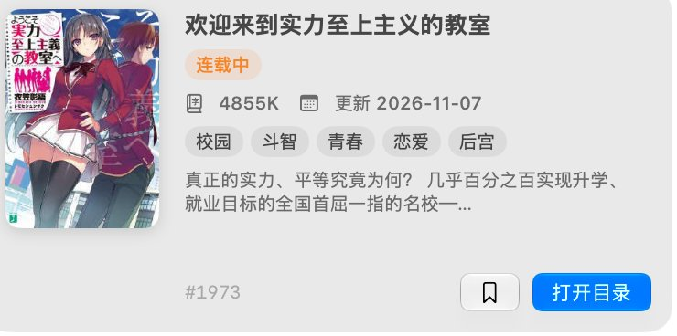

<div align="center">
  
  <h1>Wenku8 Studio</h1>
  <p><strong>轻小说文库（wenku8）macOS 原生 Liquid Glass 客户端 & 全功能 CLI EPUB 拼装工具</strong></p>

  <p>
    <a href="https://github.com/generalio/lightnovel-download/actions/workflows/ci.yml">
      
    </a>
    <a href="https://github.com/generalio/lightnovel-download/releases">
      
    </a>
    
    
    
  </p>

  <p>
    <a href="#核心特性">核心特性</a> •
    <a href="#界面预览">界面预览</a> •
    <a href="#快速开始">快速开始</a> •
    <a href="#cli-命令行指南">CLI 指南</a> •
    <a href="#epub-拼装与自定义">EPUB 拼装</a> •
    <a href="#自动构建与发版">CI/CD 发版</a>
  </p>
</div>

---

## 简介

**Wenku8 Studio** 是一套面向 [轻小说文库（wenku8）](https://www.wenku8.cc) 的轻小说阅读、目录检索与 **EPUB 3.0 / 2.0 定制拼装工具**，由两部分构成：

1. **macOS 原生桌面客户端（`Wenku8Studio.app`）**：基于 SwiftUI + macOS 26+ 原生 **Liquid Glass（液态玻璃）** 打造，零第三方依赖，提供发现与搜索、图文书架与浏览历史、可视化分卷/章节勾选、内置沉浸阅读器（含插图大图灯箱预览）、macOS 原生检查器书评楼中楼及 EPUB 拼装配置。
2. **跨平台命令行工具（`lightnovel.py`）**：轻量、无图形依赖，具备与桌面端对等的书籍检索、书评查看、终端阅读、单卷/多卷合集 EPUB 拼装能力，适合批处理与终端用户。

---

## 核心特性

### 1. 发现、检索与图文书架
- **双域名自动容灾**：默认优先请求 `https://www.wenku8.cc`，遇拦截或网络异常自动回退主站 `https://www.wenku8.net`。
- **多维度搜索与榜单**：默认加载「总点击榜」，支持最近更新、总推荐榜、月点击榜、完结专区、动画化作品，并支持按**书名 / 作者 / 书号**检索；未登录触发全站权限时支持内置网页登录一键提取 Cookie（带格式自检与有效性测试）。
- **统一图文书架与历史**：异步加载封面、作者、文库分类、状态、字数、更新时间、Tags 与简介，右上角一键收藏与删除，整卡点击直达目录。

### 2. 选章下载、书评楼中楼与内置阅读器
- **可视化分卷/章节勾选树**：自由勾选任意分卷或单个章节，支持全选、清空、反选、仅选含彩插卷、关键字过滤及范围快速勾选。
- **macOS 原生检查器书评（`.inspector`）**：在书籍详情页直接滑出书评边栏，按 `1#` 主楼 + 楼层号 + **楼中楼嵌套引用**展示真实讨论。
- **沉浸式在线阅读器**：内置章节目录侧栏、四套阅读主题（素白 / 羊皮纸 / 护眼绿 / 夜间）、黑体/楷体/宋体切换、字号/行距/段距/版心宽度调节、阅读进度记忆、方向键翻章与**插图大图灯箱预览（100%–400% 缩放、多图切换与保存）**。

### 3. 出版级 EPUB 拼装工坊
- **双规范兼容**：支持 **EPUB 3.0**（含 `nav.xhtml`、`cover-image`、`belongs-to-collection` 系列分组与 `toc.ncx` 回退）及 **EPUB 2.0**。
- **单卷 / 合集双模式**：支持每卷独立输出，或将多卷合并打包为单本带**二级嵌套目录**的全集 EPUB。
- **丰富元数据与排版定制**：自动写入文库分类、Tags、简介、更新时间与精美简介扉页（`info.xhtml`）；支持彩插独立分页、正文前/后放置、重复插图去重、清理录入组声明行、自定义封面/本地彩页、外置 CSS 样式与命名模板。

---

## 界面预览

<div align="center">
  
  <br/><br/>
  
</div>

---

## 快速开始

### 方式一：下载 macOS Release 安装包

前往 [Releases 页面](https://github.com/generalio/lightnovel-download/releases) 下载最新 `Wenku8Studio-v*-macOS-arm64.dmg` 或 `.zip`，拖入「应用程序」即可运行（macOS 26+ Apple Silicon）。

> 若首次打开提示来自未签名开发者，可在系统「隐私与安全性」中允许打开，或执行：
> ```bash
> xattr -cr /Applications/Wenku8Studio.app
> ```

### 方式二：从源码使用 Xcode 构建 macOS 客户端

需要 macOS 26+、Xcode 26+（已验证 Xcode 27.2）与 `xcodegen`：

```bash
brew install xcodegen
./Wenku8Studio/build_app.sh
open Wenku8Studio.app
```

运行 Swift 单元测试：

```bash
cd Wenku8Studio
xcodegen generate
xcodebuild test -project Wenku8Studio.xcodeproj -scheme Wenku8Studio -destination 'platform=macOS'
```

---

## CLI 命令行指南

安装 CLI 依赖（纯命令行，无需安装任何桌面 GUI 库）：

```bash
pip install -r requirements.txt -i https://pypi.org/simple/
```

### 常用命令示例

```bash
# 1. 交互模式（支持 info / search / author / toplist / reviews / thread / read 快捷指令）
python lightnovel.py

# 2. 查看书籍详情、简介、标签与分卷目录
python lightnovel.py --book_no 3115 --info

# 3. 下载单卷 / 多卷（输出为 EPUB 3.0，支持 2、1-3、1,2,3、all）
python lightnovel.py --no_input --book_no 3115 --volume_no 1-3 --out_dir ./out

# 4. 将第 1~3 卷合并为单本带二级分卷目录的合集 EPUB，并清理录入组头部声明
python lightnovel.py --no_input --book_no 3115 --volume_no 1-3 --merge --clean_credits

# 5. 按作者检索（免登录）或按书名/榜单检索（需通过 --cookie 或 WENKU8_COOKIE 传 Cookie）
python lightnovel.py --search "猫玄" --search_type author
python lightnovel.py --toplist allvisit --cookie "jieqiUserInfo=...; PHPSESSID=..."

# 6. 查看书评列表与具体帖子的楼层/楼中楼回复
python lightnovel.py --book_no 3115 --reviews
python lightnovel.py --review_id 319681

# 7. 在终端直接阅读指定卷章正文（如第 1 卷第 2 章）
python lightnovel.py --book_no 3115 --read 1:2
```

完整参数列表可通过 `python lightnovel.py --help` 查看。

---

## EPUB 拼装与自定义

| 配置项 | macOS 客户端（设置） | CLI 参数 |
| :--- | :--- | :--- |
| **规范版本** | EPUB 3.0（兼容 2.0）/ EPUB 2.0 | `--epub_version {2,3}` |
| **导出策略** | 每卷独立 / 多卷合并合集 | `--merge` |
| **封面与扉页** | 包含封面、自定义本地封面、简介扉页 | `--no_cover` / `--cover_file` / `--no_info` |
| **彩插排版** | 独立分页 / 单页拼接 / 忽略；前/后放置；追加本地彩页 | `--single_color_page` / `--no_color` / `--color_after` / `--extra_color` |
| **正文样式** | 段首缩进、行高、段间距、清理录入组声明 | `--indent` / `--line_height` / `--para_spacing` / `--clean_credits` |
| **命名与覆写** | `{title}` `{volume}` `{index}` `{author}` `{id}` | `--title` / `--author` / `--filename_template` |

---

## 自动构建与发版

仓库已配置自动化 GitHub Actions 工作流：

- **持续集成**（[ci.yml](.github/workflows/ci.yml)）：推送或 PR 至主分支时自动运行 Python CLI/EPUB 测试与 macOS Xcode 编译测试。
- **Tag 自动发版**（[release.yml](.github/workflows/release.yml)）：推送 `v*` 标签时自动运行测试、编译 `Wenku8Studio.app` 并打包发布 macOS `.dmg` 与 `.zip` 至 GitHub Releases：

```bash
git tag v2.4.0
git push origin v2.4.0
```

---

## 目录结构

```text
lightnovel-download/
├── .github/workflows/          # GitHub Actions CI & macOS Tag 自动发版工作流
├── Wenku8Studio/               # macOS 原生 SwiftUI 客户端（Liquid Glass）
│   ├── Sources/Wenku8Core/     # 网络抓取、GB18030 解析、Cookie 诊断、EPUB 组装引擎
│   ├── Sources/Wenku8Studio/   # SwiftUI 视图与状态管理
│   ├── Tests/Wenku8CoreTests/  # Swift XCTest 单元测试
│   ├── AppResources/           # 应用图标（Assets.xcassets / icon_raw.png）与 Info.plist
│   ├── project.yml             # XcodeGen 工程描述
│   └── build_app.sh            # 一键生成 .xcodeproj 并编译打包 .app
├── docs/screenshots/           # README 界面展示截图
├── Editer.py                   # Python 核心抓取、检索、书评与 EPUB 打包引擎
├── utils.py                    # Python EPUB 2/3 模板与 XML 转义工具
├── lightnovel.py               # Python CLI 入口
└── tests/test_core.py          # Python pytest 单元测试
```

---

## 免责声明

本项目仅供个人学习与离线阅读排版技术交流使用，请支持正版轻小说，勿用于商业用途或高频恶意爬取。
